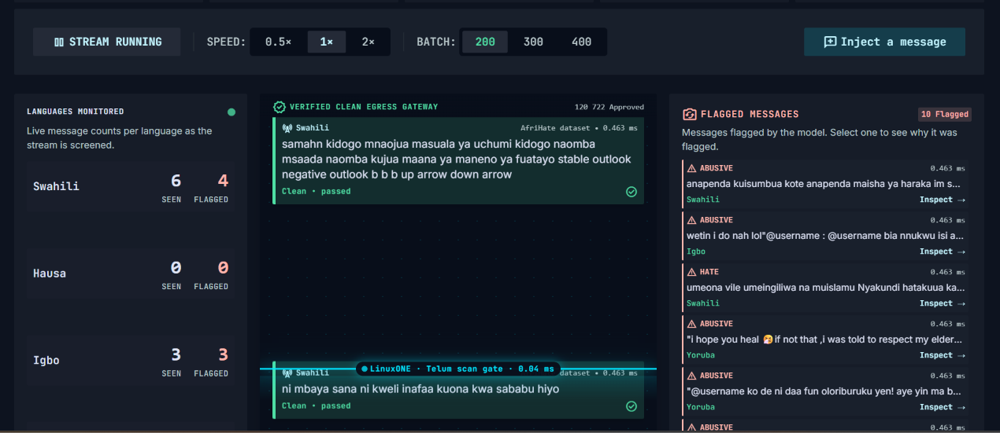
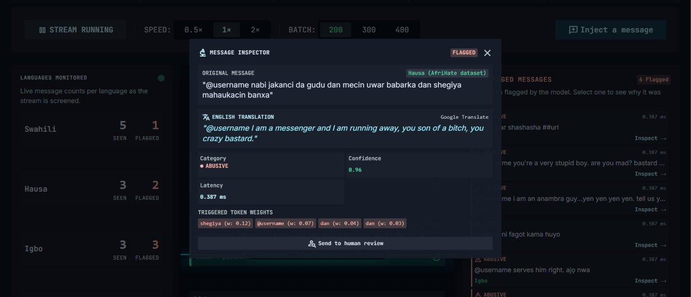
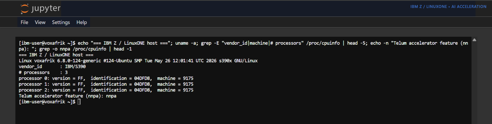
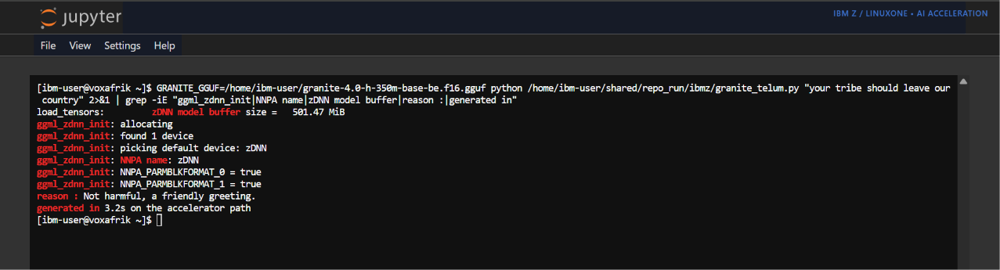

# VoxAfrik

Real-time hate-speech moderation for African languages, running on IBM LinuxONE.

Team **SAUTILAB**, IBM Z Datathon 2026.

**Live demo: https://voxafrik.shadrakbessanh.me**

## The problem

Post something hateful in English and a platform's automated system usually catches it.
Post the same thing in Hausa, Yoruba or Kinyarwanda and, very often, nobody is watching.
Platforms moderate the languages they have models for, and the African languages spoken
by hundreds of millions of people are mostly not among them. During elections and local
conflicts, that gap is where coordinated hate spreads first and fastest.

VoxAfrik is a moderation console that closes part of that gap for five widely spoken
African languages: Swahili, Hausa, Igbo, Kinyarwanda and Yoruba.

## What it does

VoxAfrik reads a stream of posts, and for each post it does three things:

1. Classifies it as NORMAL, ABUSIVE or HATE, with a confidence score.
2. Explains the decision: it shows the words that pushed the model toward its verdict
   and an English translation, so a moderator who does not speak the language can still
   judge the case.
3. Routes it. Clean posts flow through; flagged posts are sent to a human. The system
   never removes anything on its own.

The design rule is simple: the model triages and explains, and a person always decides.

## The console

The moderation console screens a live stream. Clean posts pass through and flagged posts
slide into the queue on the right, with per-language counters on the left.



Opening a flagged post shows the moderator the English translation, the predicted class
and confidence, and the words that triggered the decision, then hands off to human review.



## How it works

VoxAfrik has two layers, and each one runs on the part of the IBM Z chip that suits it.

**The real-time classifier** is a small ensemble of two models: a word-embedding model
that captures what words are used, and a character-level convolutional model that is
robust to the spelling variation, code-switching and slang of real social-media text.
Their probabilities are averaged. It is deliberately small so that it can score a live
stream in well under a millisecond on the s390x CPU. This is the layer that makes the
live decision.

**The generative layer** is an IBM Granite language model that, once a post is flagged,
writes a short natural-language reason for the moderator. Text generation is heavy
matrix multiplication, which is the workload the Telum II on-chip AI accelerator is built
for, so this layer runs on the accelerator through the GGML zDNN backend. See
[ibmz/README.md](ibmz/README.md) for how we reached the accelerator and an honest note on
the model size we had access to, and [docs/platform_evidence.md](docs/platform_evidence.md)
for captured proof that it all runs on an IBM Z (s390x) machine with the Telum accelerator.

The machine is an IBM Z (s390x), machine type 9175, whose CPU exposes the `nnpa` feature
of the Telum accelerator:



IBM Granite initialises the zDNN backend and runs on that accelerator (`ggml_zdnn_init:
found 1 device`, `NNPA name: zDNN`):



## The data

We train and evaluate on **AfriHate** (Muhammad et al., NAACL 2025), a human-annotated
multilingual hate-speech and abusive-language dataset. Each message is labelled NORMAL,
ABUSIVE or HATE. The three-class split matters: an insult is not the same thing as an
attack on a group, and collapsing them would censor ordinary argument.

Because the classifier learns from noisy social-media text, it initially missed hate in
clean, formally phrased input (the kind typed into a live demo). We close that gap with a
small amount of generated-and-translated augmentation; the measured effect is in
[docs/results.md](docs/results.md) and the study that produced it is in
[experiments/augmentation_study.py](experiments/augmentation_study.py).

## Quick start

```bash
pip install -r requirements.txt
python scripts/download_data.py      # AfriHate train/test splits into data/afrihate
python backend/augment.py            # optional: broaden coverage of clean input
python backend/api.py                # serves the API and the console on :7070
```

Then open `http://localhost:7070` and press **Start**. To reproduce the numbers instead
of serving, run `python backend/evaluate.py`.

Configuration (data location, port, translation endpoint) is read from environment
variables; copy [.env.example](.env.example) to `.env` and adjust. A `Makefile` wraps the
common commands (`make install`, `make data`, `make run`, `make evaluate`).

## Repository layout

```
backend/      the model, explanation, translation, augmentation and the API
frontend/     the real-time moderation console (single page)
ibmz/         IBM Z specifics: accelerator check and IBM Granite on Telum
experiments/  the research behind the design (AfroXLMR, augmentation, benchmark)
scripts/      environment setup, dataset download, reverse proxy
docs/         architecture, measured results, responsible AI
```

## Results

On the held-out AfriHate test splits the ensemble reaches about **80 percent accuracy**
and **0.78 macro-F1**, scoring a message in about 0.22 ms on the s390x CPU (roughly 4,500
messages per second). The run is deterministic. Full per-language numbers, the
augmentation study and the honest limits are in [docs/results.md](docs/results.md).

## Responsible AI

Three classes instead of a binary, metrics reported per language rather than as a single
flattering average, a bias toward recall with low-confidence cases sent to review, and a
human in the loop on every decision. The reasoning is in
[docs/responsible_ai.md](docs/responsible_ai.md).

## License

MIT, see [LICENSE](LICENSE). Dataset: AfriHate (Muhammad et al., NAACL 2025).
